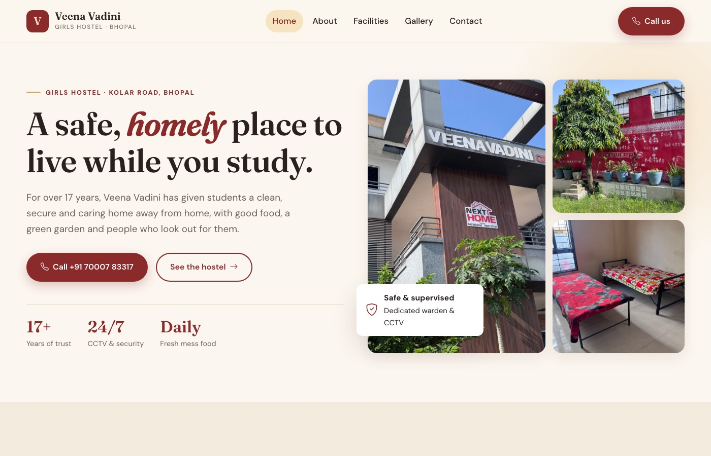
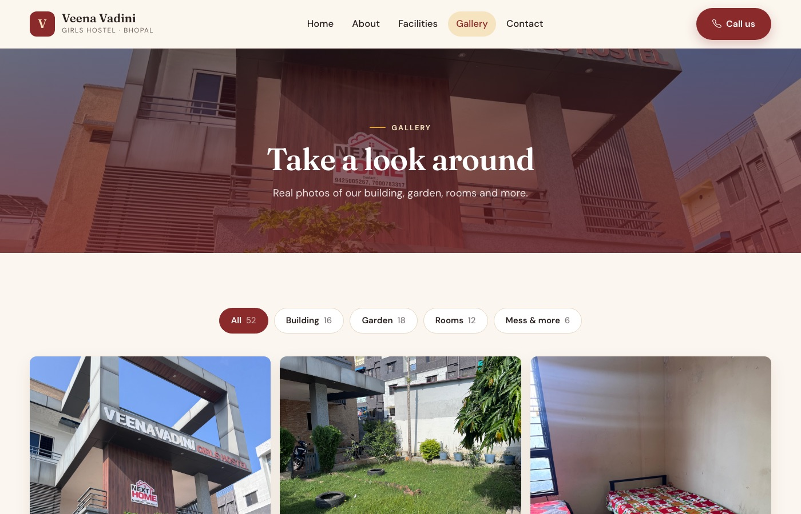

# Veena Vadini Girls Hostel

Website for **Veena Vadini Girls Hostel**, a girls' hostel on Kolar Road, Bhopal, running for over 17 years.

**Live site:** https://veenavadini-hostel.onrender.com



## Pages

| URL | Page | What's on it |
|---|---|---|
| `/` | Home | Hero with photo collage, why-choose-us cards, photo strip, chairperson's message, call-to-action |
| `/about-us/` | About | The hostel's story, chairperson and warden cards |
| `/service/` | Facilities | Nine facility cards, each with a real photo |
| `/gallery/` | Gallery | 52 photos with category filters (Building, Garden, Rooms, Mess & more) and a full-screen viewer |
| `/contact-us/` | Contact | Address, phone numbers, visiting hours and Google Map |

The site works on phones too: a collapsible menu, and a floating call button on small screens.



## Tech stack

- **Backend:** Python 3.11, Django 5.2
- **Frontend:** Django templates, Bootstrap 5.3 (grid and mobile menu), Bootstrap Icons, plus a custom stylesheet
- **Fonts:** Fraunces (headings) and DM Sans (body), from Google Fonts
- **Static files:** served by [WhiteNoise](https://whitenoise.readthedocs.io/) in production
- **Hosting:** [Render](https://render.com) (free web service), run with gunicorn

The site has no database models. SQLite is there only for Django's built-in admin and sessions.

## Project structure

```
.
├── manage.py
├── requirements.txt        # Django, gunicorn, whitenoise
├── build.sh                # Render build: install, collectstatic, migrate
├── render.yaml             # Render Blueprint config
├── wscubetech/             # Django project
│   ├── settings.py         # env-based SECRET_KEY / DEBUG, WhiteNoise, Render host
│   ├── urls.py
│   └── views.py            # page views, facilities list, gallery photo list
├── templates/
│   ├── base.html           # <head>, fonts, CSS/JS, header + footer
│   ├── header.html         # sticky nav with mobile menu
│   ├── footer.html
│   ├── index.html          # home
│   ├── aboutus.html
│   ├── service.html        # facilities
│   ├── gallery.html
│   └── contactus.html
├── static/
│   ├── css/style.css       # design system (colours, type, components)
│   ├── js/site.js          # scroll reveal, gallery filter + lightbox
│   ├── icons/              # favicon, app icons, web manifest
│   └── img/                # hostel photos (resized for the web)
└── docs/                   # README screenshots
```

## Run it locally

```bash
python3 -m venv .venv
source .venv/bin/activate
pip install -r requirements.txt
python manage.py migrate
python manage.py runserver
```

Then open http://127.0.0.1:8000. Locally, `DEBUG` is on and Django serves the static files itself.

### Check it the way Render runs it

```bash
python manage.py collectstatic --no-input
RENDER=1 RENDER_EXTERNAL_HOSTNAME=localhost SECRET_KEY=dev gunicorn wscubetech.wsgi:application
```

## Deploying

Every push to `main` makes Render rebuild and redeploy automatically.

To set it up from scratch on Render:

1. **New → Web Service**, then connect this repo (or **New → Blueprint** to use `render.yaml`).
2. Settings:
   - **Build command:** `./build.sh`
   - **Start command:** `gunicorn wscubetech.wsgi:application`
   - **Instance type:** Free
3. Environment variables:

| Key | Value |
|---|---|
| `PYTHON_VERSION` | `3.11.9` |
| `SECRET_KEY` | any long random string (use Render's **Generate**) |

Optional: set `DEBUG=True` to debug on Render, or `EXTRA_ALLOWED_HOSTS=example.com,www.example.com` for a custom domain.

On the free plan the service goes to sleep when idle, so the first visit after a while takes about 30 seconds.

## Common edits

- **Change text:** edit the matching file in `templates/`.
- **Add or remove gallery photos:** put the photo in `static/img/` (resize it to about 1600px wide first), then add its filename to the right group in `GALLERY_SECTIONS_RAW` in `wscubetech/views.py`.
- **Edit facilities:** change the `FACILITIES` list in `wscubetech/views.py`. Each entry has a title, a [Bootstrap Icon](https://icons.getbootstrap.com/) name, a photo and text.
- **Change colours or fonts:** they're all CSS variables at the top of `static/css/style.css` (`--maroon`, `--marigold`, `--cream`, and so on).
- **Phone numbers / address:** they appear in `header.html`, `footer.html`, `base.html` (call button), `index.html`, `aboutus.html`, `service.html` and `contactus.html`. Search for `7000783317` to find them all.

## Contact

**Veena Vadini Girls Hostel**
DK-1/12, Danish Kunj, Kolar Road, Bhopal, Madhya Pradesh 462042
📞 +91 70007 83317
